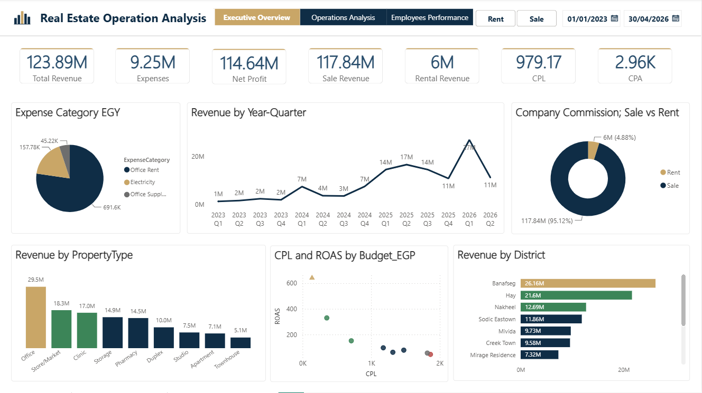
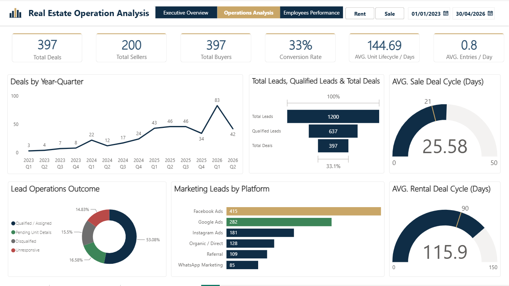
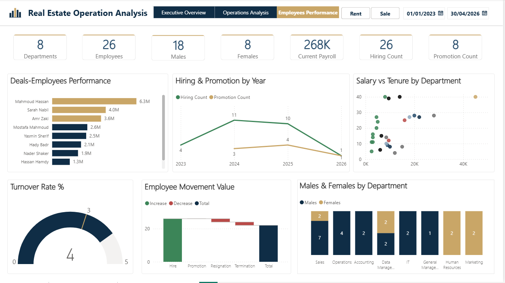

# 🏙️ Real Estate Operations Analytics

**An end-to-end data analytics solution for a New Cairo real estate resale brokerage: from synthetic data generation to a fully interactive 3-page Power BI dashboard.**

Built as a graduation capstone project (Data Analysis Diploma, Tech Mind Academy), this repository demonstrates a complete data pipeline, **Python → SQL Server → Power BI**, designed to replace a manual, paper-based operational workflow with a centralized, data-driven reporting system.

> ⚠️ **Note on Data Authenticity:** All data in this project is **synthetic**, generated in Python with enforced business rules to simulate a brokerage's operations. It does not represent any real company, and all figures in the dashboard reflect the assumptions built into the generator.

---

## 📊 Dashboard Preview

### Page 1: Executive Overview
Total Revenue, Net Profit, Expenses, CPL/CPA, Sale vs. Rental Commission split, Revenue by Property Type & District.



### Page 2: Operations Analysis
Lead-to-deal funnel, Sale vs. Rental deal cycle time (with seasonal rental patterns, peak season mid-May to mid-September), conversion rate, marketing platform performance.



### Page 3: Employees Performance
Headcount, payroll, hiring & promotion trends, turnover rate, and a salary-vs-tenure analysis testing whether retention is actually salary-driven.



> 📌 A key design principle throughout: **every KPI is built to be defensible**. For example, "Total Revenue" reports actual brokerage commission, not gross transacted property value, which would misrepresent the business by orders of magnitude.

---

## 📌 Business Case (Simulated Scenario)

A rapidly growing real estate **resale** brokerage (handling both **sale and rental** transactions on third-party inventory, not property development) has no centralized way to track sales performance, marketing ROI, employee productivity, or operating expenses. This project delivers:

- A realistic **synthetic dataset** modeling 4 years of company operations (2023–2026): 500 properties, 1,200 leads, and 400+ transactions
- A normalized **SQL Server data warehouse** (star schema, 12 tables)
- An interactive **3-page Power BI dashboard** with 35+ DAX measures

---

## 🧱 Tech Stack & Pipeline

```
Python (Google Colab)  →  Google Sheets  →  CSV  →  SQL Server  →  Power BI Desktop
   pandas, numpy            (staging /            (Import          (star-schema
   random, datetime         verification           Wizard)          model + DAX)
   gspread                  layer)
```

| Layer           | Tool                          | Role                                                                                                                                                |
| --------------- | ----------------------------- | --------------------------------------------------------------------------------------------------------------------------------------------------- |
| Data Generation | Python, pandas, numpy         | Synthetic data with enforced business rules (finishing↔furnishing↔deal-type logic, seller-type deal restrictions, realistic Egyptian work calendar) |
| Staging         | Google Sheets API (`gspread`) | Live, human-readable verification layer before committing to SQL                                                                                    |
| Data Warehouse  | Microsoft SQL Server          | Star schema with referential integrity, CHECK constraints, and FK-enforced relationships                                                            |
| BI & Analytics  | Power BI Desktop              | Semantic model, DAX measures, and a 3-page operational dashboard                                                                                    |

---

## 📂 Repository Contents

| File / Folder                                                  | Description                                                                                                       |
| -------------------------------------------------------------- | ----------------------------------------------------------------------------------------------------------------- |
| `New_Cairo_RealEstate_DW.ipynb`                                | Full data generation notebook: 12 tables, business-rule functions, reproducible via seeded randomization         |
| `RealEstate_Operations.sql`                                    | Complete data warehouse DDL: table creation, constraints, and foreign keys                                        |
| `RealEstate_Operations_DB.pbix`                                | Power BI file: data model, DAX measures, and the 3-page dashboard (requires Power BI Desktop)                     |
| [`Real_Estate_Operations_Analytics_Technical_Documentation.pdf`](Real_Estate_Operations_Analytics_Technical_Documentation.pdf) | Full technical write-up: every library choice, table design decision, DAX measure, and debugging lesson explained |
| `Dashboard_Screenshots/`                                       | Static previews of all 3 dashboard pages                                                                          |

**Recommended reading order:** this README → Technical Documentation → notebook → SQL file → dashboard screenshots (or open the `.pbix` directly in Power BI Desktop).

---

## 🗃️ Data Model

12 tables in a star schema: **8 dimensions** and **4 fact tables**.

- **Dimensions:** Properties, Clients, Sellers, Departments & Roles, Employees, Employee Career History, Marketing Campaigns, Marketing Leads
- **Facts:** Leads Operations, Sales Transactions, Rental Transactions, Monthly Expenses

Sale and rental activity are modeled as **two parallel fact tables**, a deliberate design choice reflecting that this is a resale brokerage where rental typically represents a comparable share of business to sales, not a secondary activity.

---

## 🔑 Key Technical Highlights

- **Reproducible synthetic data:** seeded random generation means the exact same dataset regenerates on every run.
- **Domain-accurate business rules enforced at
